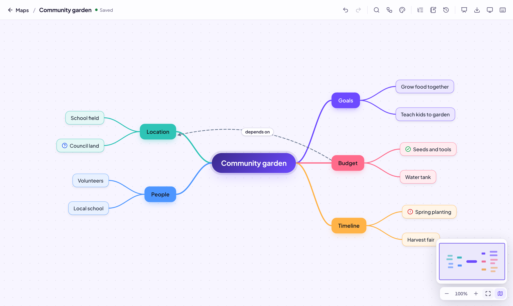
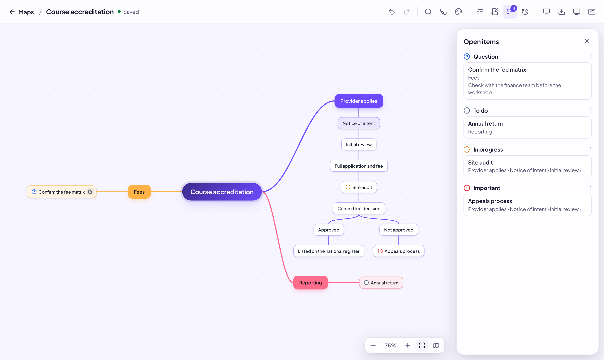
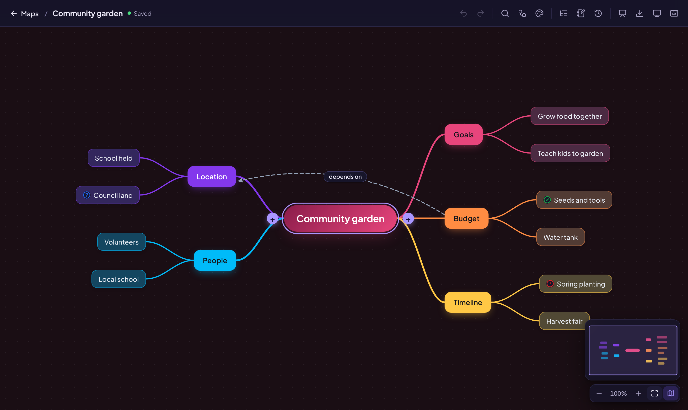
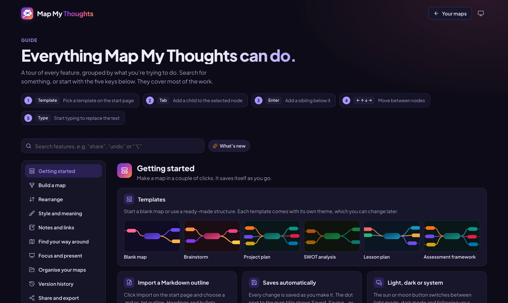

<p align="center">
  
</p>

<h1 align="center">Map My Thoughts</h1>

<p align="center">
  A fast, keyboard-first mind-mapping app that runs privately on your own computer.<br>
  Free and open source. No account, no cloud, no tracking.
</p>

<p align="center">
  
</p>

## Why Map My Thoughts?

- **Your maps stay on your machine.** Everything runs in Docker on your computer and is only
  reachable from it. Nothing is sent anywhere unless you export and share a file yourself.
- **Built for the keyboard.** `Tab` adds a child, `Enter` adds a sibling, and the arrow keys move
  between ideas. You can build a whole map without touching the mouse.
- **Looks good out of the box.** Eight colour themes, light and dark mode, and automatic layouts
  that keep big maps readable.
- **Free to use, change and share** under the [MIT licence](LICENSE).

## Features

| | |
| --- | --- |
| **Build fast** | Tab/Enter to add ideas, type to edit, paste an indented list to create whole branches, drag and drop to rearrange, undo everything |
| **Make meaning visible** | Shapes, colours, status markers (done, in progress, question, idea…), notes and web links on any node |
| **Map processes** | Lay any branch out as steps that flow straight down, splitting side by side at decisions; zoom out to 5% to see a whole process |
| **Connect ideas** | Labelled, dashed cross-links between any two nodes; links from a node to another map or to a node in it; move a big branch to its own map and link to it |
| **Track what's open** | An Open items panel lists every question, to-do, in-progress and important node, in a map or a whole collection; notes show on hover or on the map |
| **Stay oriented** | Zoom, overview map, find and replace, collapse branches, show 1–3 levels, outline view |
| **Focus and present** | Focus on one branch as if it were the whole map; present branch by branch, full screen |
| **Organise** | Collections (one per project, say), map cards with live thumbnails, templates |
| **Never lose work** | Saves as you type, works offline and catches up, named and automatic versions you can restore, daily backups |
| **Share and export** | Send a `.mmt` file to a colleague; export PNG, SVG, PDF, Word or Markdown; import Markdown outlines |

<p align="center">
  
</p>

There's a searchable **Guide** inside the app (the _Guide_ button on the start page) that explains
every feature, and `⌘/` (`Ctrl+/`) in a map shows all keyboard shortcuts.

<p align="center">
  
  
</p>

## Get started

You need **[Docker Desktop](https://www.docker.com/products/docker-desktop/)** (free for personal
use, education, non-commercial open-source projects and small businesses; check Docker's terms for
larger organisations) and **git**.

```bash
git clone https://github.com/crespire-fj/mapmythoughts.git
cd mapmythoughts
docker compose up -d --build
```

The first build takes a few minutes. Then open **http://localhost:8080**.

That's it. The app restarts by itself whenever Docker Desktop starts, so it's there whenever you
need it. To always have it available, turn on _Docker Desktop → Settings → General → Start Docker
Desktop when you sign in_.

**Use it like a normal app:** in Safari choose **File → Add to Dock**, or in Chrome or Edge choose
**Install page as app** from the menu. Map My Thoughts then opens in its own window with its own icon.

| To…                    | Run                                                                       |
| ---------------------- | ------------------------------------------------------------------------- |
| Stop it                | `docker compose down` (your maps are kept)                                |
| Start it again         | `docker compose up -d`                                                    |
| Update to the latest   | `git pull` then `docker compose up -d --build`                            |
| See what it's doing    | `docker compose logs -f`                                                  |
| Use a different port   | copy `.env.example` to `.env`, set `MMT_PORT`, then start it again |

If you have Node.js installed, `npm run up`, `npm run down` and `npm run logs` do the same things.

**Tested on** macOS with Docker Desktop. Linux with Docker Engine and the Compose plugin should work
the same way. Windows hasn't been tested; running it inside WSL 2 is the most likely to work.

## Your data

- **Where it lives:** a Postgres database in the Docker volume `mapmythoughts-pgdata`. It survives
  restarts, rebuilds, updates and `docker compose down`.
- **Daily backups:** while the app is running, a compressed copy of the database is saved to the
  `MapMyThoughts-backups` folder in your home folder once a day. Copies older than 14 days are
  deleted. To use another folder (one that's synced to the cloud, say), set `MMT_BACKUP_DIR` in
  `.env` (see `.env.example`).
- **Back up now:** `./scripts/backup.sh` (or `npm run backup`).
- **Restore:** `./scripts/restore.sh ~/MapMyThoughts-backups/<file>.sql.gz` replaces every map with
  the backup's contents. It asks you to confirm first.
- **Per-map history:** open _History_ in a map to save a named version or restore an earlier one.
  A version is also kept automatically every 30 minutes while you edit.

> [!WARNING]
> Docker Desktop's **Troubleshoot → Clean / Purge data** and **Reset to factory defaults** delete
> all volumes, including your maps. Only the backups in `~/MapMyThoughts-backups` would survive.
> Consider keeping that folder somewhere that's also backed up or synced.

## Sharing with other people

Each person runs their own copy. To share a map, use a map card's **⋯ → Export file to share**, or
**Export → Map My Thoughts file** inside a map. To share a whole collection, use the export button on
the collection's page. Send the `.mmt` file however you like; the other person clicks **Import** on
their start page. Notes, links, markers, styles, cross-links, layout and theme all come across, and
maps go back into a collection with the same name. Files from before the rename (`.eqapmap`) still
import.

## Privacy and security

- The app listens on `127.0.0.1` only, so other computers on your network can't reach it.
- There are **no accounts and no sign-in**: anyone who can use your computer can open your maps.
  Don't change the port mapping to expose it to a network or the internet.
- The database password is only used inside Docker's private network; the database is never
  published to your computer or network.
- Uploaded map thumbnails are checked on the server and served so that they can't run scripts.
- Nothing is collected or sent anywhere. There's no telemetry.

## Keyboard shortcuts

On Windows and Linux, use `Ctrl` for `⌘` and `Alt` for `⌥`.

| Key                          | Action                                                     |
| ---------------------------- | ---------------------------------------------------------- |
| Tab / Enter                  | Add child / sibling (also while typing)                    |
| Shift+Enter                  | Line break inside a node                                   |
| Arrow keys                   | Move between nodes                                         |
| Type, F2 or double-click     | Edit (typing replaces the text)                            |
| ⌥↑ / ⌥↓                      | Move a node up / down among its siblings                   |
| ⌥→ / ⌥←                      | Indent / outdent                                           |
| ⌘C / ⌘X / ⌘V                 | Copy, cut, paste branches (pasted text becomes branches)   |
| ⌘D                           | Duplicate branch                                           |
| Delete or Backspace          | Delete branch                                              |
| ⌘F / ⌥⌘F                     | Find in map / find and replace                             |
| ⌘A, Shift-click, Shift-drag  | Select several nodes                                       |
| ⌘. / ⌥1, 2, 3, 0             | Collapse a branch / show 1, 2, 3 or all levels             |
| ⌘I                           | Notes, link and marker for the selected node               |
| ⌥L                           | Cross-link to another node                                 |
| ⌥F / ⌥P                      | Focus on a branch / present                                |
| ⌥S                           | Lay the branch out as steps (on or off)                    |
| ⌘Z / ⇧⌘Z                     | Undo / redo                                                |
| ⌘= / ⌘− / ⌘0                 | Zoom in / out / fit                                        |

## Development

Requires Node 24 and Docker Desktop.

```bash
npm install && npm --prefix server install
npm run up        # database + sync server (+ the built app on :8080)
npm run dev       # live-reloading front end on http://localhost:5173, using the running stack
```

Changes to the server (`server/src`) need `npm run up` to rebuild the `sync` container.

| Command             | What it checks                                                             |
| ------------------- | -------------------------------------------------------------------------- |
| `npm run check`     | Lint, type checks (app and server) and unit tests                          |
| `npm test`          | Unit tests: layout, connectors, commands, undo, keyboard, files, contrast  |
| `npm run e2e`       | Browser tests (Playwright) against the running app; run `npm run up` first |
| `npm run format`    | Prettier                                                                   |

The browser tests create and delete their own maps; they don't touch yours. To test a copy on
another port, set `MMT_URL` (for example `MMT_URL=http://localhost:8090 npm run e2e`). The first time, install
the test browser with `npx playwright install chromium`.

### How it works

Each map is a [Yjs](https://yjs.dev) document, synced to a small Node server with
[Hocuspocus](https://tiptap.dev/docs/hocuspocus) over a WebSocket and stored in Postgres. The front
end is React and TypeScript (built with Vite) and draws the map itself: a pure layout function places
nodes, connectors are computed geometry, and every change goes through a small set of commands so
each one is a single undo step. nginx serves the app and proxies the sync server and REST API.

```
src/model/        map document schema and read helpers
src/commands/     the only code that changes a map; each command is one undo step
src/layout/       two-sided tree layout (pure functions)
src/connectors/   connector and cross-link geometry (pure functions)
src/keyboard/     shortcut registry
src/selection/    arrow-key navigation
src/editor/       the map canvas, nodes, panels and toolbar
src/export/       PNG, SVG, PDF, Word, Markdown and .mmt files; thumbnails
src/maps/         start page, collections and API client
src/guide/        the in-app guide
src/theme/        colour themes and contrast rules
server/src/       sync server and REST API, storing maps in Postgres
docker/           Dockerfiles and nginx config
scripts/          backup and restore
e2e/              Playwright browser tests
```

## Contributing

Issues and pull requests are welcome. Please run `npm run check` and `npm run e2e` before opening a
pull request, and add a test for anything you fix or add.

## Licence

[MIT](LICENSE). Use it, change it and share it freely.

Map My Thoughts uses the Plus Jakarta Sans font (SIL Open Font Licence) and Lucide icons (ISC
licence).
